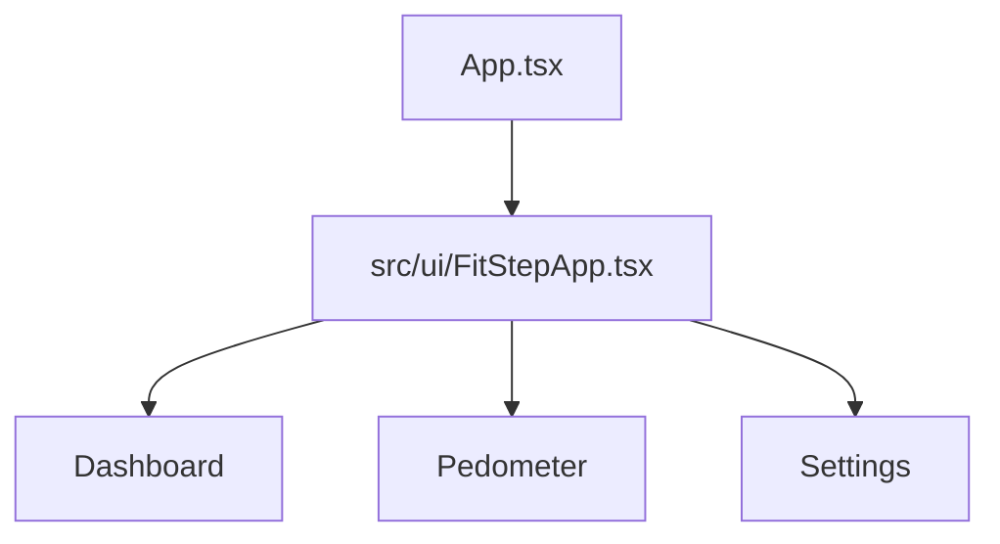

# Aufbau · Sprint 0

Die App verwendet Expo, React Native und TypeScript. Der Einstiegspunkt `App.tsx` umschliesst die Oberfläche mit `SafeAreaProvider` und zeigt `src/ui/FitStepApp.tsx`. Die Ansichten berücksichtigen damit die sicheren Bildschirmbereiche.

Die Tab-Navigation und der gemeinsame visuelle Aufbau liegen unter `src/ui/`. Die Oberfläche folgt der Referenz mit dunklem Hintergrund, abgerundeten Karten und orangefarbenen Akzenten.

## Entwicklungsregeln

- **KISS:** Ein überschaubarer Einstiegspunkt und drei klar benannte Ansichten.
- **DRY:** Gemeinsame Farben, Abstände und wiederkehrende UI-Elemente zentral halten.
- **YAGNI:** Dieser Projektstand enthält das vereinbarte Grundgerüst.
- **Lesbarkeit:** Aussagekräftige Namen und kleine Komponenten; Regeln durch TypeScript und die vereinbarten Prüfungen absichern.

Die Fachlogik wird erst mit den Funktionen des folgenden Projektstands ergänzt.
