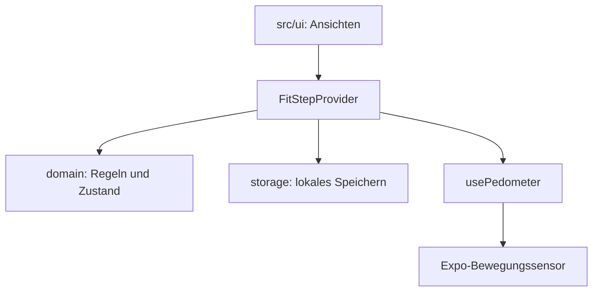

# Aufbau · Sprint 1

`App.tsx` bindet den sicheren Bildschirmbereich und den `FitStepProvider` ein. Die Oberfläche liest ihren Zustand über `useFitStep`.

| Bereich | Aufgabe |
|---|---|
| `src/domain/dates.ts` | Lokale Kalendertage und Datumszuordnung. |
| `src/domain/progress.ts` | Fortschritt und verbleibende Schritte berechnen. |
| `src/domain/model.ts` | Datenmodell, Zustandsänderungen und Validierung. |
| `src/state/FitStepProvider.tsx` | Zustand, Speicherung und Sensordaten für die UI verbinden. |
| `src/services/storage.ts` | Lokale Daten lesen und schreiben. |
| `src/hooks/usePedometer.ts` | Verfügbarkeit, Berechtigungen und plattformspezifische Sensoraktualisierung. |
| `src/ui/` | Ansichten, Eingaben und wiederverwendbare Darstellung. |

## Konkrete Regeln

- Ein Tagesziel ist eine ganze Zahl von 1 bis 1'000'000.
- Fortschritt = heutige Schritte / Tagesziel × 100, auf ganze Prozent gerundet. Solange das Tagesziel nicht erreicht ist, bleibt die Anzeige höchstens bei 99 % (zum Beispiel 7'999 / 8'000 → 99 %). Der Zahlenwert darf über 100 % liegen; der Fortschrittsring wird bei 100 % vollständig gefüllt.
- Die Woche umfasst heute und die sechs vorherigen lokalen Kalendertage.
- Live- und Demo-Schrittverläufe bleiben getrennt. Live-Daten beginnen leer.
- Sensorabonnements werden beim Deaktivieren beziehungsweise Wechsel in den Hintergrund aufgeräumt.

## Prinzipien und Grenzen

**Single Responsibility:** Datumsrechnung, Fortschrittsrechnung, Speicherung und Sensorzugriff haben eigene Bereiche. **DRY:** Beide Ansichten verwenden dieselben abgeleiteten Schritt- und Fortschrittswerte. **KISS:** Ein Provider und einfache Domänenfunktionen reichen für den vereinbarten Umfang. **YAGNI:** Die App speichert lokal; zusätzliche Infrastruktur folgt erst aus einer konkreten Anforderung.

Die CI prüft den Code und erstellt einen Export als Artefakt. Eine Veröffentlichung gehört nicht zu dieser CI-Prüfung.
