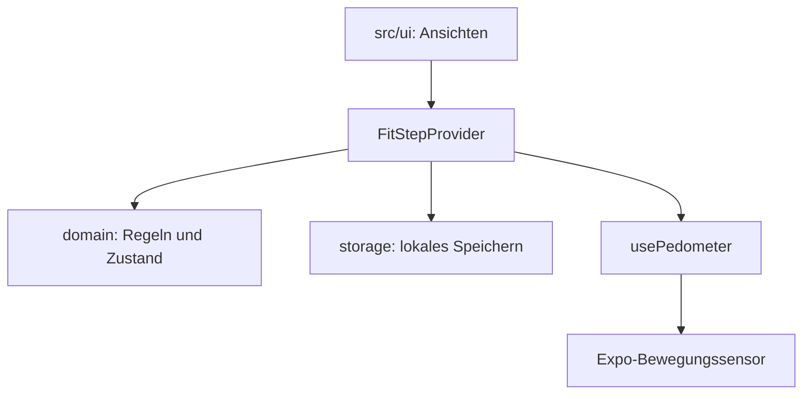

# Aufbau · Sprint 2

`App.tsx` bindet den sicheren Bildschirmbereich und den `FitStepProvider` ein. Die Oberfläche verwendet den Hook `useFitStep`.

| Bereich | Verantwortung |
|---|---|
| `src/domain/dates.ts` | Lokale Kalendertage und Zuordnung der Schritte. |
| `src/domain/progress.ts` | Fortschritt, Restschritte und abgeleitete Anzeigewerte. |
| `src/domain/model.ts` | Datenmodell, Zustandsänderungen und Validierung einschliesslich Profil und eigener Ziele. |
| `src/state/FitStepProvider.tsx` | Daten, Aktionen, Speicherung und Sensor für die Ansichten verbinden. |
| `src/services/storage.ts` | Gespeicherten Zustand lesen und schreiben. |
| `src/hooks/usePedometer.ts` | Verfügbarkeit, Berechtigung und plattformspezifische Sensoraktualisierung. |
| `src/ui/` | Dashboard, Pedometer, Settings und gemeinsame Darstellung. |

## Fachregeln

- Tagesziel: ganze Zahl zwischen 1 und 1'000'000.
- Profilname: 1–40 Zeichen; eigener Zieltext: 1–120 Zeichen; leere Texte sind ungültig.
- Fortschritt = heutige Schritte / Tagesziel × 100, auf ganze Prozent gerundet. Solange das Tagesziel nicht erreicht ist, bleibt die Anzeige höchstens bei 99 % (zum Beispiel 7'999 / 8'000 → 99 %). Der Zahlenwert darf über 100 % liegen; der Fortschrittsring wird bei 100 % vollständig gefüllt.
- Geschätzte Distanz = Schritte × 0,75 / 1'000 Kilometer.
- Der Wochenverlauf zeigt heute und die sechs vorherigen lokalen Kalendertage.
- Live- und Demo-Schrittverläufe sind getrennt. Live-Daten beginnen leer.
- Eigene Ziele haben eine stabile ID und einen gespeicherten Erledigungszustand.

## Prinzipien an diesem Aufbau

**Single Responsibility:** Kalenderrechnung, Domänenregeln, Speicherung, Sensorzugriff und Darstellung sind getrennte Aufgaben. **DRY:** Ansichten verwenden denselben Zustand und dieselben berechneten Werte. **KISS:** Ein gemeinsamer Provider koordiniert die überschaubare lokale App. **YAGNI:** Health-Anbindung wird im dafür vorgesehenen Sprint ergänzt.

Die CI führt Prüfungen aus und erstellt einen Export als Artefakt. Das ist eine CI-Prüfung; eine Deployment-Pipeline wird damit nicht behauptet.

## Health-Ausblick

Der Bewegungssensor liefert die derzeitige Schrittquelle. Für Epic 7 müssen die Zielplattform, Health-Berechtigungen, Datenquelle und erforderliche native Build-Umgebung separat umgesetzt und auf einem passenden Gerät geprüft werden.
